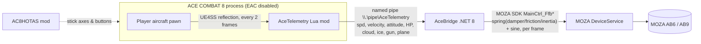

# AceCombat8MozaFFB (AceFFB): force feedback for ACE COMBAT 8 on MOZA AB6 / AB9 flight bases

**Version 0.5.1 — direct drive through the MOZA SDK, with a live-tuning control panel.**
Download from [Releases](https://github.com/lanzer/AceCombat8MozaFFB/releases).

> **What changed in 0.5.1:** AceBridge is now a pure **GUI application — no console window
> at all**. Every log line (our own `[ffb]/[pipe]/[live]` output and the MOZA SDK's
> INFO/DEBUG/WARN lines) goes straight into the control panel's log box. Scripts that need text
> output (e.g. the installer's `AceBridge --test` probe) still get it when they redirect stdout.

> **What changed in 0.5.0:** a small **control panel window** now opens with AceBridge by
> default: **Gain** and **Vib** sliders adjust the force strength and rumble scale **in real time**
> while you fly, and a **live log panel** mirrors everything the program prints — including the MOZA
> SDK's own INFO/DEBUG/WARN lines (captured via its official log callback). Closing the window exits
> AceBridge cleanly. Pass `--nogui` for scripted headless use.

> **What changed in 0.4.5:** the sine **period is in milliseconds, not microseconds**. Sending
> DirectInput-style microseconds made the base interpret a 50 000 value as a 50-second cycle — no
> vibration at all (this was why gun fire felt dead). Gun 28 ms, cloud 70 ms, ice 90 ms, stall 110 ms.

> **What changed in 0.4.4:** registration now follows the SDK's official working example order —
> `NewEffect` → **send an initial parameter block** → `EffectOperation Start`. Starting an effect
> before its parameters can ACK successfully while producing no force. `NewEffect`/`EffectOp`/`Control`
> now log their return codes, and `--test` gained a **Constant-force phase** (the SDK's canonical
> pattern) as the first, most reliable bench check.

> **What changed in 0.4.3:** every effect now uses a finite **duration (65535 ms)** refreshed every
> frame. `duration=0` was being interpreted as 0 ms (effect ends instantly), which made every force —
> spring, damper and gun rumble alike — register and ACK but never physically play.

> **What changed in 0.4.2:** prints the base's `Main_CtrlFfbEnable` value and warns if FFB is
> disabled; clearer message when no game telemetry is arriving.

> **What changed in 0.4.1:** device discovery now polls the SDK for up to ~5 s instead of
> querying once — the base shows up ~150 ms after initialization, and a single query missed
> it. `-test` / `--test` (single or double dash) both work, and Ctrl+C shuts the SDK down
> cleanly (no ZeroMQ teardown assert).

> **What changed in 0.4.0 (the "direct drive" rewrite).** Earlier versions made AC8's
> telemetry look like DCS telemetry and handed it to **MOZA Cockpit's DCS mode**, which needed a
> real DCS World sitting idle at its main menu to work. 0.4.0 removes DCS and Cockpit from the
> loop entirely: AceBridge now talks to the base **directly through MOZA's official SDK**
> (`MOZA_SDK.dll`) and plays every force — centering spring, damper, friction, inertia and all
> rumble — straight onto the base via the SDK's `MainCtrl_Ffb*` commands. The per-plane feel is
> now in `config/ffb-profiles.json` (ported from the old Cockpit presets) and switched inside
> AceBridge when you pick a plane.

## Main feature: every plane gets its own stick feel, automatically

When you pick a plane in AC8, its own force profile loads automatically in AceBridge. The 32
profiles in `config/ffb-profiles.json` give every AC8 plane its own spring, damper, friction,
inertia and rumble strength: heavy, old-school stick loads on the Phantom and Tomcat, a light
fly-by-wire feel on fifth-gen fighters, and a soft, twitchy stick on the experimental jets.
Giving each one its own feel makes them worth flying again.

AceFFB gives ACE COMBAT 8: Wings of Theve (PC/Steam) real force feedback on a **MOZA AB6 or
AB9** FFB flight base. It was tested on the AB6; the AB9 should work the same way because it uses
the same SDK FFB commands. AC8 has no FFB output of its own, so AceFFB reads the player
aircraft's state from inside the game and turns it into:

- **Stick loading from G and speed.** The centering spring is scaled in real time by the smoothed
  G-load (heavier when you pull hard) and by airspeed (light and sloppy at low speed). This is now
  done by AceBridge itself over the SDK — no Cockpit telemetry mode.
- **Rumble effects** played directly on the base through the SDK:
  - gun fire (only while you're actually firing)
  - hits, in three tiers: light (bullets), heavy (missile or collision), destroyed
  - cloud buffet, scaled by cloud density
  - icing
  - a sonic boom pulse when you cross Mach 1
  - stall shake below a configurable speed (default 200 km/h)

> ⚠️ **Anti-cheat / ban risk.** This uses a UE4SS script mod, which requires launching AC8 with
> **Easy Anti-Cheat disabled**. Use it **only in the offline single-player campaign**. Never go
> into ACE COMBAT ONLINE / multiplayer with UE4SS installed or EAC bypassed. Remove or disable
> the mods and restore the normal EAC launch first. Bandai Namco has no published policy on mods.
> **You use this at your own risk.**

## Requirements

| What | Notes |
|---|---|
| ACE COMBAT 8 (Steam, Windows 11) | Offline campaign, launched with EAC disabled (see the warning above) |
| UE4SS **v3.0.1 Beta (Git SHA 03dbd5c0)** | The build tested with AC8 (UE 5.4). The AC8HOTAS "full install" package bundles this exact build. Other UE4SS builds are untested. |
| [AC8 HOTAS Support](https://github.com/Drumsmasher17/AC8HOTAS) (recommended) | Lets the game read the AB6 directly as a flight stick. Its INSTALL guide also covers launching with EAC disabled. |
| MOZA Cockpit **installed** (any recent version) | Only so that **MOZA DeviceService** runs in the background — the SDK talks to the base through it. You do **not** need Cockpit's DCS/telemetry mode, presets, or the export port. |
| **MOZA SDK `MOZA_SDK.dll`** | Redistributed with the release next to `AceBridge.exe`. If you build from source, pass `-SdkDll` to `build.ps1` (see below). |
| .NET 8 Runtime (x64) | Only needed for the framework-dependent build. Not needed for a `-SelfContained` build. |
| MOZA AB6 or AB9 FFB base | Tested on the AB6. The AB9 should work the same (same SDK FFB commands, untested). The base must be powered and connected, with force feedback enabled on it. |

## Install

### Quick install: run `Install-AceFFB.cmd`

Extract the release zip anywhere, close the game, then double-click **`Install-AceFFB.cmd`**. It asks
for administrator rights if the game folder needs them, walks you through each step, and ends
with a summary of what's done and what's left (`[OK]`, `[SKIP]`, `[ACTION NEEDED]`):

1. **Finds ACE COMBAT 8** in your Steam libraries (or lets you pick the folder).
2. **Offline launch without anti-cheat:** after you type `YES`, it puts `steam_appid.txt` (the game id
   `2288340`) next to `AceCombat8.exe` and adds an **"ACE COMBAT 8 (offline, no EAC)"** desktop shortcut
   (`AceCombat8.exe -SaveToUserDir`). Offline campaign only, see the warning above.
3. **UE4SS:** uses yours if it's installed. If not, it can download the tested build (UE4SS v3.0.1 Beta
   03dbd5c0, from the AC8HOTAS full-install package on GitHub, checked by SHA-256), which also brings
   AC8HOTAS and AC8AnalogYaw.
4. **AceTelemetry:** copies the mod into `UE4SS\Mods` and enables it in `mods.txt` (and `mods.json`).
5. **MOZA setup:** checks that a MOZA service process (DeviceService / Cockpit) is running and probes
   the base through `MOZA_SDK.dll` with `AceBridge --test`. If no base is found, it tells you what to
   check. (No DCS script, no port, no Cockpit presets are touched.)
6. **AceBridge:** copies it to `%USERPROFILE%\AceFFB` (you can change it), verifies `MOZA_SDK.dll` is
   next to it, adds a desktop shortcut and checks for the .NET 8 Runtime.
7. **Key bindings (AC8HOTAS):** lets you pick the standard or the trigger-missile layout and fills in your
   MOZA base's device ID. The controller list only appears after the game has run once with AC8HOTAS, so on
   a fresh install, start the game once, quit, and run the installer again.

Every file is backed up before it's changed (to `%LOCALAPPDATA%\AceFFB\backups`), and it's safe to rerun.
Finished steps are skipped. **`Uninstall-AceFFB.cmd`** undoes it: it removes the mod, `steam_appid.txt`,
AceBridge and the shortcuts, restores your old bindings, and removes UE4SS if the installer added it.
Run it before you play online. To preview without changing anything, run
`Install-AceFFB.cmd -DryRun` (or `Uninstall-AceFFB.cmd -DryRun`) from a command prompt.

### Manual install

0. **Offline launch without EAC.** Create `ACE COMBAT 8\Game\Binaries\Win64\steam_appid.txt` containing
   just `2288340`, then start the game by running
   `Game\Binaries\Win64\AceCombat8.exe -SaveToUserDir` instead of Play in Steam.
1. **UE4SS.** Install UE4SS v3.0.1 Beta into `ACE COMBAT 8\Game\Binaries\Win64` so you have
   `Win64\dwmapi.dll` and `Win64\UE4SS\`. The easiest route is the AC8HOTAS full-install package.
2. **AceTelemetry mod.** Copy `mod\AceTelemetry` (or `Mods\AceTelemetry` from the release zip) to
   `ACE COMBAT 8\Game\Binaries\Win64\UE4SS\Mods\AceTelemetry`, then add this line to
   `UE4SS\Mods\mods.txt`:
   ```text
   AceTelemetry : 1
   ```
3. **AceBridge.** Download the release zip and extract it anywhere, or build it yourself:
   ```powershell
   powershell -ExecutionPolicy Bypass -File scripts\build.ps1            # needs .NET 8 SDK
   powershell -ExecutionPolicy Bypass -File scripts\build.ps1 -SelfContained
   ```
   The output goes to `release\AceFFB-<version>\` along with a zip for a GitHub Release. `build.ps1`
   auto-detects `MOZA_SDK.dll` under `%USERPROFILE%\Downloads` and copies it next to `AceBridge.exe`; if
   yours is elsewhere, pass `-SdkDll "C:\path\MOZA_SDK.dll"`. AceBridge will not start without it.
4. **Optional: AB6/AB9 bindings (AC8HOTAS).** Same as before — see
   [examples/AC8HOTAS-bindings-AB6.lua](examples/AC8HOTAS-bindings-AB6.lua) and the trigger-missile
   variant. Replace the device GUID with your own, copy to `Mods\AC8HOTAS\bindings.lua`, select
   *Expert* flight controls in game, then press **F5**.

## Run order

1. **Make sure MOZA DeviceService is running** — start MOZA Cockpit once if unsure (it keeps
   DeviceService in the background).
2. **AceBridge**: run `Start-AceBridge.cmd`. No console window appears — the **control panel**
   opens directly with a live log and two sliders (**Gain** / **Vib**). Drag them while flying to
   tune the feel in real time. The log shows `[ffb] MOZA SDK FFB ready on "MOZA AB6 FFB Base"` (or
   your AB9) and, once a plane is detected, `[ffb] plane <code> -> profile <name>`.
3. **ACE COMBAT 8** (EAC disabled). When you're in a mission, the log shows
   `[pipe] game mod connected`, followed by `[live]` status lines every 2 seconds.

You can start or restart AceBridge while the game is running; the mod reconnects by itself. No DCS, no
MOZA Cockpit telemetry mode, no Cockpit presets, no export port.

**Hot reload:** after editing `Mods\AceTelemetry\Scripts\main.lua`, press **Ctrl+R** in game to
reload UE4SS Lua mods. Force feedback comes back after a few seconds.

## Tuning

Command-line options for AceBridge, passed through `Start-AceBridge.cmd` (for example
`Start-AceBridge.cmd --vib 0.8 --gain 1.2`):

| Option | Default | Meaning |
|---|---|---|
| `--vib <scale>` | `1.0` | Overall strength of all rumble effects (0–1+); also the **Vib** slider in the control panel |
| `--gain <scale>` | `1.0` | Master strength for **all** forces — spring, damper, friction, inertia and rumble. This is the "overall strength" knob that used to live in MOZA Cockpit; also the **Gain** slider in the control panel |
| `--stall-kmh <kmh>` | `200` | Stall shake starts below this speed and grows stronger as you slow down. It only applies once airborne (after exceeding this speed + 120 km/h). |
| `--map <file>` | see below | Path to `ffb-profiles.json` |
| `--aircraft <profile>` | `FA-18C-AC8` | Force profile used before a plane is identified |
| `--nogui` | — | No control panel. Intended for scripts that capture stdout (e.g. the installer's `AceBridge --test` probe); without a console or a redirect, output is invisible. |
| `--test` | — | Bench: drives constant/spring/damper/friction/inertia/sine one after another so you can verify wiring and calibrate scales/frequencies on your actual base, then exits (console only) |

Settings that are code constants (edit and rebuild, or press Ctrl+R for the Lua file):

| Setting | Where |
|---|---|
| Gun detection window (0.14 s) | `GUN_WINDOW` in `mod/AceTelemetry/Scripts/main.lua` |
| G smoothing and clamp (−4…+12 G) | `ForceLoop` in `bridge/AceBridge/Program.cs` |
| Per-effect rumble strength and frequency: gun 0.30, cloud 0.22, ice 0.38, stall 0.42 | `MozaFfb.Update` in `bridge/AceBridge/MozaSdk.cs` (`Take(level * strength, periodMs)`) |
| Hit pulses: light 0.35, heavy 0.65 (≥10 % health lost), destroyed 0.85 | `ffb.Pulse(...)` in `bridge/AceBridge/Program.cs` |
| Sonic boom pulse 0.42 (Mach 1 = 340 m/s, re-arms below Mach 0.93) | `ffb.Pulse(0.42, 100, 280)` in `Program.cs` |
| Effect indices (spring=1, damper=2, friction=3, inertia=4, sine=5, constant=6) and command IDs | `MozaNative` in `bridge/AceBridge/MozaSdk.cs` |

**How the forces map to the SDK:** AceBridge registers six effects on the base
(`MainCtrl_FfbNewEffect`): Constant (diagnostic bench only), Spring, Damper, Friction, Inertia
(condition effects, updated per frame via `MainCtrl_FfbCondition`) and Sine (rumble, via
`MainCtrl_FfbPeriodic`). Coefficients use a `0–10000` scale (= 0–100 %) and the sine period is in
**milliseconds** (DirectInput's microsecond convention was wrong for this SDK and made rumble play a
multi-second cycle). Every effect is sent with a long duration and re-sent each frame so it never
expires. If a force feels too strong/weak or a rumble frequency feels off on your base, use `--test`
and adjust the **Gain**/**Vib** sliders (or the `--gain` / `--vib` knobs), or edit the constants
above.

## Force profiles (`ffb-profiles.json`)

`config/ffb-profiles.json` (copied next to `AceBridge.exe` in the release) does two jobs:

- **`map`** maps AC8 plane codes to profile names. The plane code comes from the player pawn class
  `BP_PlayerPlane_PPxxxx_<code>_C`, lower-cased, with leading zeros in numbers removed. The **first
  matching prefix wins**, so put more specific entries (for example `f15e`) before shorter ones
  (`f15`). Unknown planes use `default`, and AceBridge logs
  `[ffb] no profile for '<code>' ... Add it to ffb-profiles.json`.
- **`profiles`** holds the per-plane feel. These are the tuned spring/damper/friction/inertia/rumble
  percentages from the old MOZA Cockpit presets, now played straight on the base by AceBridge. Each
  profile can also override `gain` (master strength), `gload` and `speedload` (how the centering
  spring loads up under G and airspeed; `1.0` = default). Fifth-gen fighters are always stronger in
  AC8, so the older jets are easy to ignore — the profiles keep the old tuning: heavy Tomcat/Phantom
  (spring ~50), light fly-by-wire 4.5-gen (spring 25–30), very light fifth-gen (spring ~20), and the
  experimental jets lightest of all (spring 15).

AceBridge looks for the file in this order: `--map`, then next to the exe, then `..\config\`, then
the repo `config\` folder (when run from `bin\`), then `.\config\`. It reloads at start-up; edit the
file and restart AceBridge.

## Tip: twisting the stick for yaw

If you use the AB6's twist axis for yaw, the force-feedback return spring makes twisting hard work.
Wrap badminton grip tape around the middle of the stick, where your thumb, middle finger and ring
finger rest. The extra grip lets you twist with much less force and cuts down on fatigue.

## Troubleshooting

- **Log panel freezes or stops updating.** Since 0.5.1 there is no console (the old console
  QuickEdit pause bug no longer applies). If the log panel ever stalls, restart AceBridge — the
  force loop and log drain run on separate threads and recover on restart.
- **No force at all checklist:**
  1. `AceBridge --test` (or the installer's step 5) shows `[ffb] MOZA SDK FFB ready`. If instead you
     see `Moza_Initialize failed` / `no MOZA devices found`, make sure MOZA Cockpit (DeviceService)
     is running, the base is powered and connected, and its force feedback is enabled. The base must
     be detected by DeviceService.
  2. `[pipe] game mod connected`. If not: check `AceTelemetry : 1` in `mods.txt`, that UE4SS loaded
     (its console or `UE4SS.log` shows `[AceTelemetry] loaded v2`), and that EAC is disabled.
  3. The `[live]` lines show `G=` changing when you pull. If they show "no aircraft", you're in a
     menu, cutscene or loading screen — output is paused there on purpose (a gentle centering spring
     stays on).
- **Stick is too stiff / too floppy:** lower or raise `--gain` (all forces) or the profile's
  `spring`/`damper` in `ffb-profiles.json`. If it's stiff even when AceBridge is stopped, MOZA
  Cockpit's own spring setting is adding force — in Cockpit set the base's **Spring to 0** (and other
  effects low) so only AceBridge's forces act. That is optional, but gives the cleanest result.
- **Rumble feels wrong (too weak / wrong frequency):** use the **Vib** slider (or `--vib`) to scale
  rumble, and check `--test`'s sine phases (50 ms and 5 ms). The period is in milliseconds; if a
  frequency still feels off, adjust the `Take(...)` periodMs constants in `MozaSdk.cs`.
- **AC8HOTAS bindings don't apply:** press **F5** in game and read the newest
  `Mods\AC8HOTAS\HOTAS-*.log`. A newly assigned device can need a **USB unplug/replug** followed
  by F5. Use *Expert* flight controls.
- **Pitch is reversed:** set `invert = true` (or `false`) on `Pitch` and press F5.
- **Yaw doesn't work:** on the AB6 (check the AC8HOTAS detected list for the AB9), yaw/twist is the
  **Rz** axis ("Z Rotation" in Windows), not Z. Bind `Yaw = { device = "...", input = "Rz" }`. If yaw
  still feels on/off instead of proportional, also install AC8AnalogYaw (bundled with AC8HOTAS).
- **Gun rumble lingers or stutters:** adjust `GUN_WINDOW` in main.lua and press Ctrl+R.

## How it works



- **AceTelemetry** (`mod/`) finds the player pawn through possession hooks, so it never scans
  objects while a map is loading. Roughly 30 times a second it writes one line:
  speed, world velocity, pitch/yaw/roll, health, missile alert, throttle, cloud/ice state, gun
  firing and plane code.
- **AceBridge** (`bridge/`) calculates G-load and angular rates from successive samples, picks the
  plane's force profile, and drives the base **directly over the MOZA SDK**: five effects
  (Spring/Damper/Friction/Inertia/Sine) are registered once, then updated per frame
  (`MainCtrl_FfbCondition` for the conditions, `MainCtrl_FfbPeriodic` for the sine). DCS and MOZA
  Cockpit's telemetry mode are not involved at all — only MOZA DeviceService, which the SDK uses to
  reach the base, has to be running.

## Credits

- [UE4SS (RE-UE4SS)](https://github.com/UE4SS-RE/RE-UE4SS), the Unreal Engine scripting system
  this mod runs on (MIT).
- [AC8 HOTAS Support / AC8HOTAS](https://github.com/Drumsmasher17/AC8HOTAS) by Drumsmasher17
  (also on [Nexus Mods](https://www.nexusmods.com/acecombat8wingsoftheve/mods/8)), for direct
  stick/throttle bindings. Bundled with [AC8AnalogueYaw](https://github.com/Drumsmasher17/AC8AnalogueYaw).
- The **MOZA SDK** (`MOZA_SDK.dll`, C API) that drives the base's force feedback. MOZA's SDK and
  DeviceService belong to MOZA Racing; check their developer program's terms for redistribution.
  This project redistributes `MOZA_SDK.dll` next to `AceBridge.exe` as shipped by MOZA.
- ACE COMBAT is a trademark of Bandai Namco Entertainment. This is an unofficial fan project
  and isn't affiliated with Bandai Namco or MOZA.

## License

[MIT](LICENSE) © 2026 Derek Liu.
